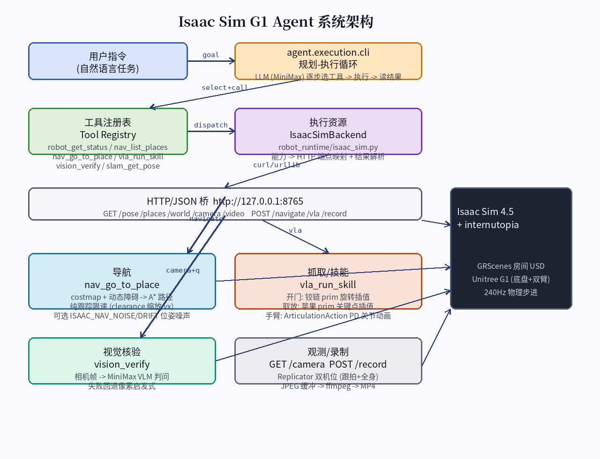
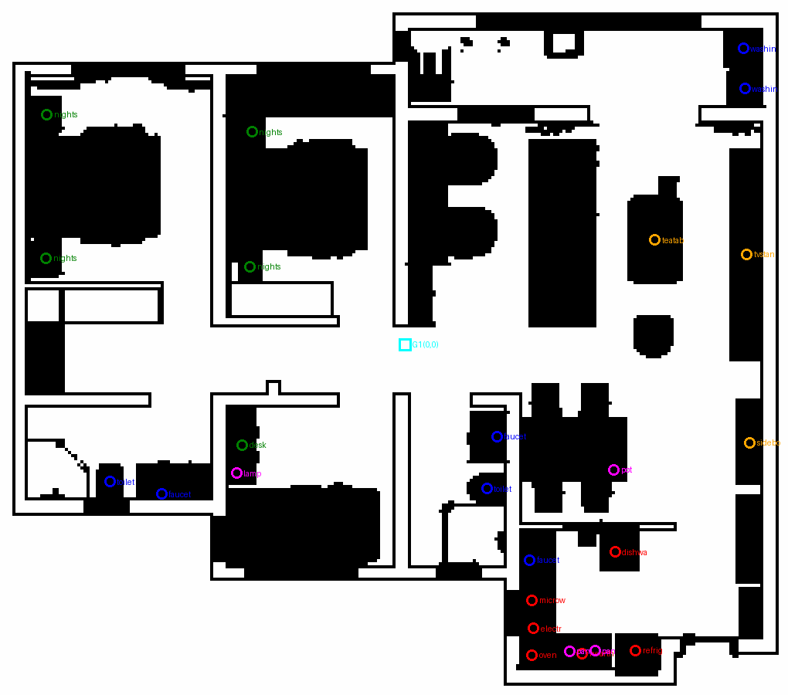
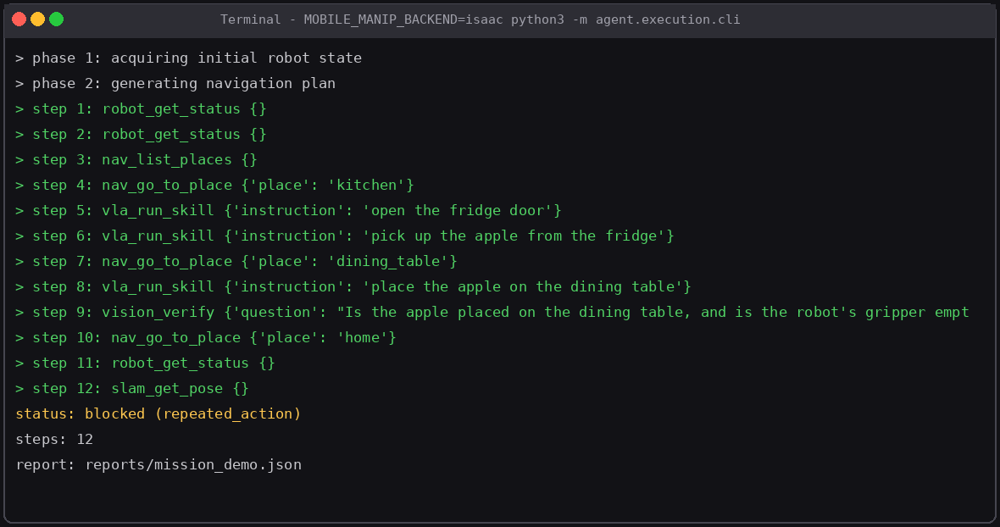

# Self-Test Agent

[](https://github.com/zhuzhu-WQ595/g1-mobile-manip-agent/actions/workflows/ci.yml)
[](LICENSE)
[]()

A contract-driven agent framework with an embodied mobile-manipulation demo on
**Isaac Sim + Unitree G1**. A natural-language goal is planned and executed by an
LLM tool loop — navigation, scripted manipulation skills, VLM verification —
recorded to a dual-view MP4.

> Learning-oriented project: the loop is a hand-rolled ReAct variant with
> capability contracts, execution-resource scheduling, approvals, and
> physics/VLM result verification instead of blind tool calls.

## Demo

Mission: *"Go to the kitchen, open the fridge, pick the apple, carry it to
the dining table and place it."*

<p align="center">
  
</p>

<p align="center">
  
</p>

<p align="center">
  
  
</p>

🎥 Full dual-view mission video:
[`docs/report_assets/isaac_rec.mp4`](docs/report_assets/isaac_rec.mp4)
(~4 min, 238 s real-time @5 fps capture).

📺 Narrated explainer (CN):
[`agentic_video/agentic_robotics_explainer.mp4`](agentic_video/agentic_robotics_explainer.mp4)
(~6.7 min, generated by `agentic_video/make_video.py`).

## Highlights

- **ReAct-style agent loop** (`agent/agent_loop.py`) with per-turn capability
  selection, permission checks, error circuit-breakers and repeat-action guards
- **Capability contracts** (`contracts/`, `agent/capabilities/`) — every tool
  declares its domain / execution target / risk level; the registry validates
  catalog ↔ schema consistency at startup
- **Execution dispatcher** (`agent/scheduling/`) — resource selection, busy
  marking, heartbeat, consecutive-failure health tracking
- **Planning & approvals** — structured plans, blocked-step diagnosis,
  human-in-the-loop approval queue for risky actions
- **Embodied demo** — `scripts/isaac_bridge.py` runs an HTTP bridge inside
  Isaac Sim (internutopia + GRScenes): occupancy-map A* navigation, scripted
  fridge/apple skills with articulated arm animation, VLM `vision_verify`,
  dual-camera Replicator recording to MP4

## Architecture

```
user goal ──> agent.execution.cli (LLM plan-execute loop)
                    │  tool call
                    ▼
        CapabilityRegistry ──> ExecutionDispatcher ──> ExecutionResource
                    │                                      │ HTTP :8765
                    ▼                                      ▼
              permissions /                         scripts/isaac_bridge.py
              approvals                                     │
                                                    Isaac Sim 4.5 (headless)
                                                    internutopia · G1 · GRScenes
```

Layout:

| Path | Contents |
|---|---|
| `agent/` | agent loop, models, planning, capabilities, toolkit, scheduling, robot tools |
| `contracts/` | `CapabilitySpec`, `ExecutionRequest/Event`, resource dataclasses |
| `robot_runtime/` | robot gateway adapters (`isaac_sim.py`, `microduck_adapter.py`, `ros2_adapter.py`) |
| `scripts/` | `isaac_bridge.py` (sim bridge + HTTP API + recorder), `cam_view.html`, map generators |
| `maps/` | prebuilt occupancy map for the GRScenes MWBGLK_Q8 scene |
| `services/` | demo services (perception etc.) |
| `evaluations/` | task runner / evaluation harness |
| `tests/` | pytest suite incl. mobile-manipulation contract tests |
| `docs/` | architecture notes, agent-vs-opensource comparison, learning guide, reports |

## Quickstart — local agent (no sim required)

```bash
python -m agent.main
```

Runs with a deterministic demo model by default. For a real LLM, copy
`.env.example` to `.env` and set `API_KEY` / `MODEL_ID` / `BASE_URL`
(OpenAI-compatible endpoint).

## Quickstart — Isaac Sim mobile-manipulation mission

Requires Isaac Sim 4.5 + internutopia + GRScenes assets.

```bash
# 1. start the sim bridge
INTERNUTOPIA_ASSETS_PATH=/path/to/GRScenes \
python scripts/isaac_bridge.py \
  --scene /path/to/start_result_navigation.usd --map maps/MWBGLK_Q8

# 2. record + run a goal
curl -X POST localhost:8765/record -d '{"cmd":"start","fps":5}'
MOBILE_MANIP_BACKEND=isaac python3 -m agent.execution.cli \
  --mobile-manip --max-steps 18 --output reports/mission.json \
  "Go to the kitchen, open the fridge, pick the apple, carry it to the
   dining table and place it, then return home."
curl -X POST localhost:8765/record -d '{"cmd":"stop"}'   # -> /tmp/isaac_rec.mp4
```

Live camera viewer: `http://localhost:8765/view`.

## Docs

- `docs/agent_execution_chain.md` — execution chain walkthrough
- `docs/agent_vs_opensource.md` — comparison vs LangGraph / AutoGPT / SayCan / MCP
- `docs/agent_learning_guide.md` — how this repo was built, learning roadmap
- `docs/IsaacSim_G1_Agent_项目演示报告.docx` — full demo report (CN)

## License

MIT — see [LICENSE](LICENSE).
