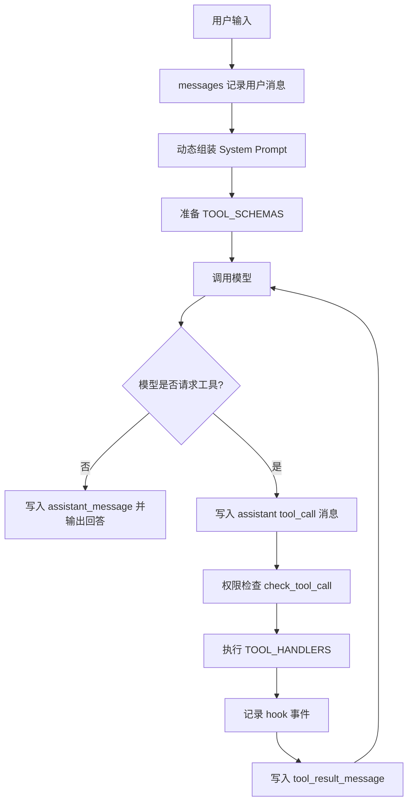
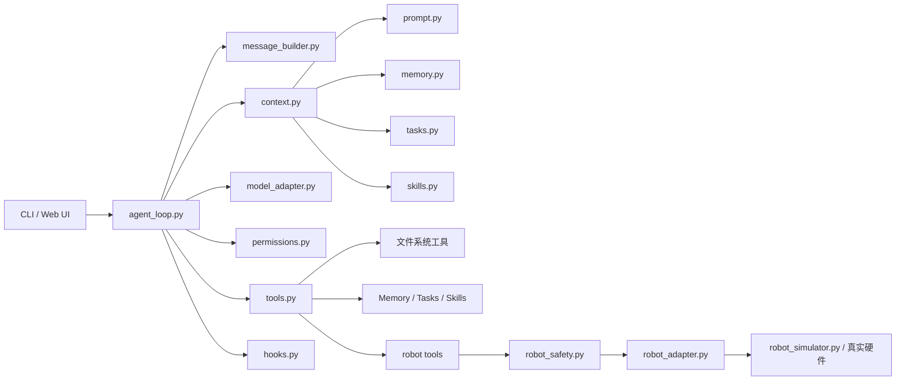
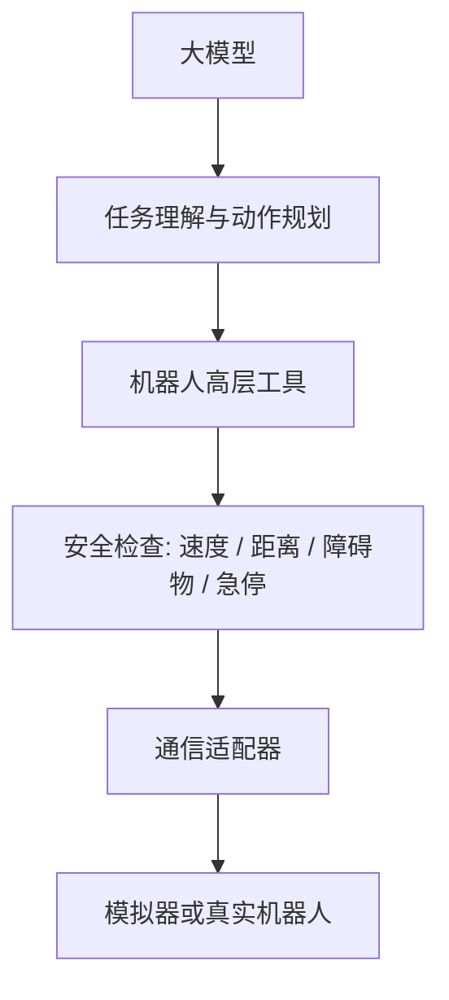

# self-test Agent 执行链路说明

这份文档用于把当前 `self-test` 项目从“已经实现的代码”整理成“能讲清楚的 Agent 架构”。重点不是新增功能，而是说明现有系统已经如何完成最小 Agent 闭环。

## 1. 当前结论

`self-test` 已经实现了一个最小 Agent 主流程，并在此基础上加入了 memory、task、skills、hooks、Web UI 和 robot simulator 等扩展。

最小 Agent 主链路已经具备：

- `messages`：保存用户、模型、工具调用和工具结果。
- `TOOL_SCHEMAS`：向模型描述可用工具。
- `TOOL_HANDLERS`：把工具名映射到 Python 函数。
- `Agent.run_turn_with_trace()`：完成模型调用、工具执行和结果回填。
- `check_tool_call()`：在工具执行前做权限检查。
- `build_system_prompt()`：根据当前上下文动态组装 system prompt。

## 2. 核心执行链路

```text
用户输入
  ↓
Agent.run_turn_with_trace(text)
  ↓
user_message(text) 写入 messages
  ↓
build_system_prompt(messages)
  ↓
model.complete(messages, TOOL_SCHEMAS, system_prompt)
  ↓
模型返回普通文本？
  ├─ 是：assistant_message(text) 写入 messages，返回最终回答
  └─ 否：模型返回 tool_calls
        ↓
      assistant_tool_call_message(tool_calls) 写入 messages
        ↓
      对每个 tool_call 执行：
        ↓
      check_tool_call(name, arguments)
        ↓
      TOOL_HANDLERS[name](**arguments)
        ↓
      record_tool_event(event)
        ↓
      tool_result_message(call_id, name, result) 写入 messages
        ↓
      回到下一轮 model.complete(...)
```

这条链路对应 Claude Code 学习内容里的主线：

```text
模型决策 -> 工具执行 -> 结果回填 -> 模型继续决策
```

## 3. 可视化架构图

### 3.1 最小 Agent 闭环



### 3.2 self-test 模块关系



### 3.3 机器人方向迁移关系



## 4. 核心文件职责

| 文件 | 职责 | 对应学习重点 |
|---|---|---|
| `agent/agent_loop.py` | 主循环，处理模型调用、工具调用、结果回填 | s01-s02 |
| `agent/tools.py` | 定义 `TOOL_SCHEMAS` 和 `TOOL_HANDLERS` | s02 |
| `agent/permissions.py` | 工具执行前检查路径、命令和工具权限 | s03 |
| `agent/hooks.py` | 记录工具事件 | s04 |
| `agent/context.py` | 动态组装 system prompt | s10 |
| `agent/prompt.py` | 基础 system prompt | s10 |
| `agent/message_builder.py` | 构造 user、assistant、tool_result 消息 | s01-s02 |
| `agent/model_adapter.py` | 适配 demo model 和 OpenAI-compatible 模型 | s01-s02 |
| `agent/memory.py` | 保存和读取长期记忆 | s09 |
| `agent/tasks.py` | 本地任务列表 | s12 |
| `agent/skills.py` | 内置技能说明 | s07 |
| `agent/robot/*` | 机器人协议、安全、适配器和模拟器 | 机器人扩展 |

## 5. 主链路代码对应关系

### 5.1 用户输入进入 messages

入口在 `agent/agent_loop.py`：

```text
self.messages.append(user_message(text))
```

意义：用户输入不是临时字符串，而是进入对话历史，后续模型每轮都能看到上下文。

### 5.2 动态组装 system prompt

入口在 `agent/context.py`：

```text
build_system_prompt(messages)
```

它会组合：

- 基础 `SYSTEM_PROMPT`
- 长期记忆 memory
- 当前任务 tasks
- 可用技能 skills
- 工作区摘要 workspace summary

意义：system prompt 不是固定文本，而是根据当前运行状态生成。

### 5.3 工具描述传给模型

入口在 `agent/tools.py`：

```text
TOOL_SCHEMAS
```

意义：这是“告诉模型它可以调用什么工具”的部分。模型只能根据 schema 选择工具名和参数。

### 5.4 工具名映射到真实函数

入口在 `agent/tools.py`：

```text
TOOL_HANDLERS
```

意义：模型返回的是工具名和参数，真正执行依赖 Python 函数映射。

### 5.5 工具执行前权限检查

入口在 `agent/permissions.py`：

```text
check_tool_call(name, arguments)
```

意义：任何工具在执行前都必须先经过权限检查。路径工具会限制在 workspace 内，命令工具只允许白名单命令，机器人工具再进入 robot safety 层。

### 5.6 工具结果回填 messages

入口在 `agent/agent_loop.py`：

```text
self.messages.append(tool_result_message(call["id"], name, result))
```

意义：工具执行结果必须重新交给模型，否则模型不知道工具执行后的真实结果，也无法继续判断下一步。

## 6. 当前系统已经超过最小 Agent 的部分

最小 Agent 只需要：

```text
messages + tools + handlers + agent_loop + permissions + prompt
```

当前 `self-test` 额外增加了：

- Web UI：通过浏览器交互。
- Memory：长期记忆。
- Tasks：本地任务列表。
- Skills：内置技能说明。
- Hooks：工具事件记录。
- Robot tools：机器人高层工具。
- Robot safety：机器人动作安全校验。
- Robot adapter：模拟器或真实硬件适配层。

所以当前项目不是“刚好最小”，而是“已经实现最小闭环，并加入若干扩展模块”。

## 7. 自测用例

可以用以下问题验证是否真正理解和跑通主流程。

### 7.1 基础对话

```text
你好，简单介绍一下你能做什么。
```

验证点：

- 模型可以不调用工具，直接返回文本。
- `assistant_message` 会写入 messages。

### 7.2 文件读取

```text
read README.md
```

验证点：

- 模型选择 `read_file`。
- `check_tool_call` 检查路径在 workspace 内。
- `TOOL_HANDLERS["read_file"]` 执行真实读取。
- `tool_result_message` 回填读取结果。

### 7.3 文件写入

```text
write notes/test.txt :: hello from self-test
```

验证点：

- 模型选择 `write_file`。
- 权限检查允许写入 workspace 内路径。
- 文件工具执行成功。

### 7.4 搜索文件

```text
search README agent
```

验证点：

- 模型选择 `search_files`。
- 搜索结果作为 tool result 回到模型。

### 7.5 命令白名单

```text
python version
```

验证点：

- 模型选择 `run_command`。
- 命令必须命中白名单。

### 7.6 越界路径拦截

```text
读取 ../Claude学习.md
```

验证点：

- `resolve_workspace_path` 应拒绝 workspace 外路径。
- 工具失败被包装成错误结果，而不是让程序崩溃。

### 7.7 机器人状态

```text
robot_get_status
```

验证点：

- 模型选择 robot tool。
- robot tool 经过 adapter 获取模拟器状态。

### 7.8 机器人安全动作

```text
Move forward 0.3 meters slowly
```

验证点：

- 模型选择 `robot_move`。
- robot safety 检查移动距离和速度。
- 默认进入 simulator，不直接控制真实硬件。

### 7.9 阶段二扩展工具

```text
get workspace summary
```

验证点：

- 模型可以选择新工具 `get_workspace_summary`。
- `TOOL_SCHEMAS` 中已经声明该工具。
- `TOOL_HANDLERS` 能找到对应 handler。
- `permissions.py` 会放行这个无副作用统计工具。
- 工具结果会回填给模型，并整理成最终回答。

预期结果包含：

```text
Workspace: self-test
Files: ...
Directories: ...
Python files: ...
Markdown files: ...
```

### 7.10 阶段三带参数扩展工具

```text
count python files
```

验证点：

- 模型可以选择新工具 `count_files_by_extension`。
- 模型能从自然语言中提取参数，例如 `python` -> `.py`。
- `TOOL_SCHEMAS` 中已经声明 `extension` 参数。
- `TOOL_HANDLERS` 能找到对应 handler。
- `permissions.py` 会放行这个只读统计工具。
- handler 会根据传入后缀返回不同统计结果。

还可以测试：

```text
count markdown files
count .js files
count txt files
```

预期工具调用示例：

```text
> count_files_by_extension {'extension': '.py'}
```

### 7.11 阶段四多参数和规则校验工具

```text
show first 5 lines of README.md
```

验证点：

- 模型可以选择新工具 `preview_file_head`。
- 模型能从自然语言中提取两个参数：`path` 和 `lines`。
- `permissions.py` 会先检查 `path` 是否在 workspace 内。
- handler 会检查 `lines` 是否在 1 到 50 之间。
- `agent_loop.py` 会拒绝模型把用户请求的行数自动改成其他值。
- `agent_loop.py` 会拒绝模型在预览失败后切换到 `read_file` 等其他工具继续执行。
- 合法参数返回文件前 N 行。
- 非法行数会返回错误结果，而不是直接执行。

还可以测试：

```text
preview README.md 3 lines
show first 1000 lines of README.md
show first 5 lines of ../Claude学习.md
```

预期工具调用示例：

```text
> preview_file_head {'path': 'README.md', 'lines': 5}
```

### 7.12 阶段五实验记录工具

```text
save experiment note :: 阶段四完成，验证了 preview_file_head 的参数校验
```

验证点：

- 模型可以选择新工具 `save_experiment_note`。
- 工具只接收 `note`，不让模型决定写入路径。
- handler 会把实验记录追加到固定文件 `notes/experiment_log.md`。
- 每条记录带本地时间戳，便于回看实验过程。

预期工具调用示例：

```text
> save_experiment_note {'note': '阶段四完成，验证了 preview_file_head 的参数校验'}
```

### 7.13 阶段六用户确认机制

```text
overwrite notes/test.txt :: new content
```

验证点：

- 模型调用 `request_overwrite_file`，只创建待审批动作，不直接写文件。
- 待审批动作保存到 `.agent_state/approvals.json`。
- 返回 `approval_id` 给用户。
- 用户输入 `approve approval_001` 后，模型调用 `approve_pending_action`。
- 只有批准后才真正覆盖文件。

预期工具调用示例：

```text
> request_overwrite_file {'path': 'notes/test.txt', 'content': 'new content'}
> approve_pending_action {'approval_id': 'approval_001'}
```

### 7.14 阶段七计划生成与步骤状态

```text
create plan 验证项目结构 :: 读取 README.md; 统计 Python 文件; 总结模块职责
```

验证点：

- 模型调用 `create_plan` 创建多步骤计划。
- 计划保存到 `.agent_state/plans.json`。
- `list_plans` 可以查看计划。
- `update_plan_step` 可以更新某一步状态。
- 创建计划不会自动执行步骤。

预期工具调用示例：

```text
> create_plan {'title': '验证项目结构', 'steps': ['读取 README.md', '统计 Python 文件', '总结模块职责']}
> list_plans {}
> update_plan_step {'plan_id': 'plan_...', 'step_index': 1, 'status': 'done'}
```

### 7.15 阶段八下一步建议

```text
suggest next step for plan_1783946166475
```

验证点：

- 模型调用 `suggest_next_plan_step`。
- 工具查找计划中第一个 `pending` 步骤。
- 工具返回下一步内容和建议工具。
- 工具不会执行该步骤，也不会修改步骤状态。

预期工具调用示例：

```text
> suggest_next_plan_step {'plan_id': 'plan_...'}
```

### 7.16 阶段九执行单个计划步骤

```text
execute step 2 of plan_1783946166475
```

验证点：

- 模型调用 `execute_plan_step`。
- 工具读取指定计划和步骤。
- 只支持少量明确步骤类型，例如读取 README、统计 Python 文件、统计 Markdown 文件、查看工作区摘要。
- 执行成功后才把该步骤标记为 `done`。
- 不支持的步骤不会执行，状态不变。
- 不会自动执行整个计划。

预期工具调用示例：

```text
> execute_plan_step {'plan_id': 'plan_...', 'step_index': 2}
```

### 7.17 阶段十执行下一步计划

```text
execute next step of plan_1783946166475
```

验证点：

- 模型调用 `execute_next_plan_step`。
- 工具自动找到第一个 `pending` 步骤。
- 只执行这一个步骤，不自动执行整个计划。
- 执行成功后该步骤变为 `done`。
- 没有 pending 步骤时返回完成提示。

预期工具调用示例：

```text
> execute_next_plan_step {'plan_id': 'plan_...'}
```

### 7.18 阶段十一执行结果写回计划

验证点：

- `execute_plan_step` 或 `execute_next_plan_step` 执行成功后，步骤不只变成 `done`。
- 步骤会保存 `result`，记录该步骤的工具执行结果。
- 步骤会保存 `completed_at`，记录完成时间。
- `list_plans` 会展示每个已完成步骤的结果预览。
- 手动把步骤改回 `pending` 或 `in_progress` 时，会清理旧结果，避免误导。

计划步骤示例：

```json
{
  "index": 2,
  "content": "统计 Python 文件",
  "status": "done",
  "result": "Extension: .py\nCount: 24",
  "completed_at": 178394...
}
```

### 7.19 阶段十二失败原因写回计划

验证点：

- 当计划步骤不支持自动执行时，步骤不再保持普通 `pending`。
- 步骤会变成 `blocked`，表示需要人工处理或后续扩展能力。
- 步骤会保存 `error`，记录阻塞原因。
- `list_plans` 会展示 blocked 状态和 error。
- 手动把步骤改回 `pending` 或 `in_progress` 时，会清理旧 error。

示例：

```text
3. [blocked] 汇总结果并输出
   error: unsupported step type
```

## 8. 面向汇报的表述

可以这样总结当前项目：

> 当前 `self-test` 已经实现了一个最小可运行 Agent 闭环。用户输入会进入 messages，系统动态组装 prompt 并把工具 schema 提供给模型；模型如果请求工具，程序会先进行权限检查，再通过 handler 执行本地工具或机器人工具；执行结果会作为 tool result 回填到 messages，再交给模型继续判断。这个流程说明我已经把 Claude Code 学习中的核心 Agent 链路落到了自己的项目中。

如果强调机器人方向，可以补充：

> 在机器人方向上，当前项目已经把机器人能力封装为高层工具，并加入 robot safety 和 adapter 层。后续接真实机器人时，不需要让大模型直接控制底层电机，而是让模型通过结构化工具提出动作请求，再由安全层和适配器转成可控的机器人指令。

## 9. 下一步建议

当前不建议继续盲目增加新功能。更合理的推进顺序是：

1. 先用上面的自测用例完整跑通主链路。
2. 给每个测试记录输入、触发工具、返回结果。
3. 汇报时用三张图说明：最小闭环、模块关系、机器人迁移结构。
4. 如果要继续开发，优先补测试和日志展示，而不是马上加 MCP、多 Agent 或定时任务。
