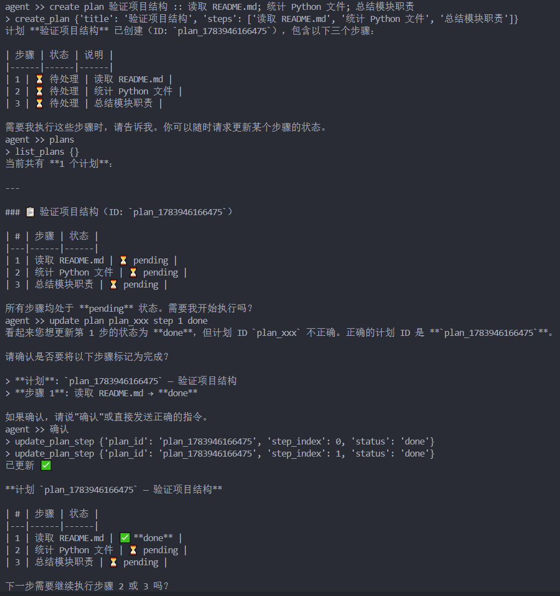
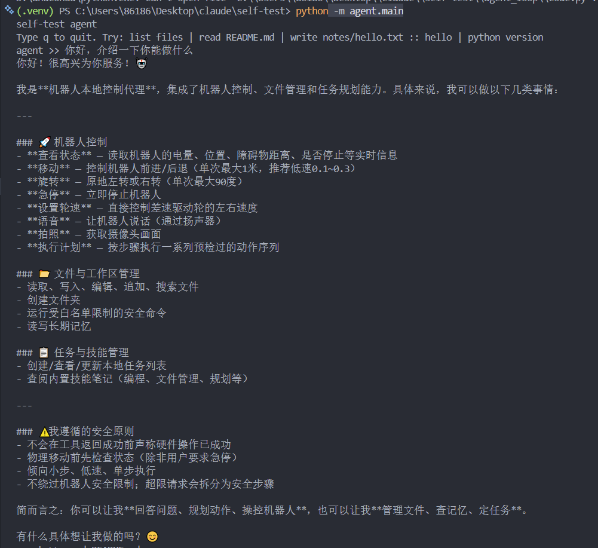
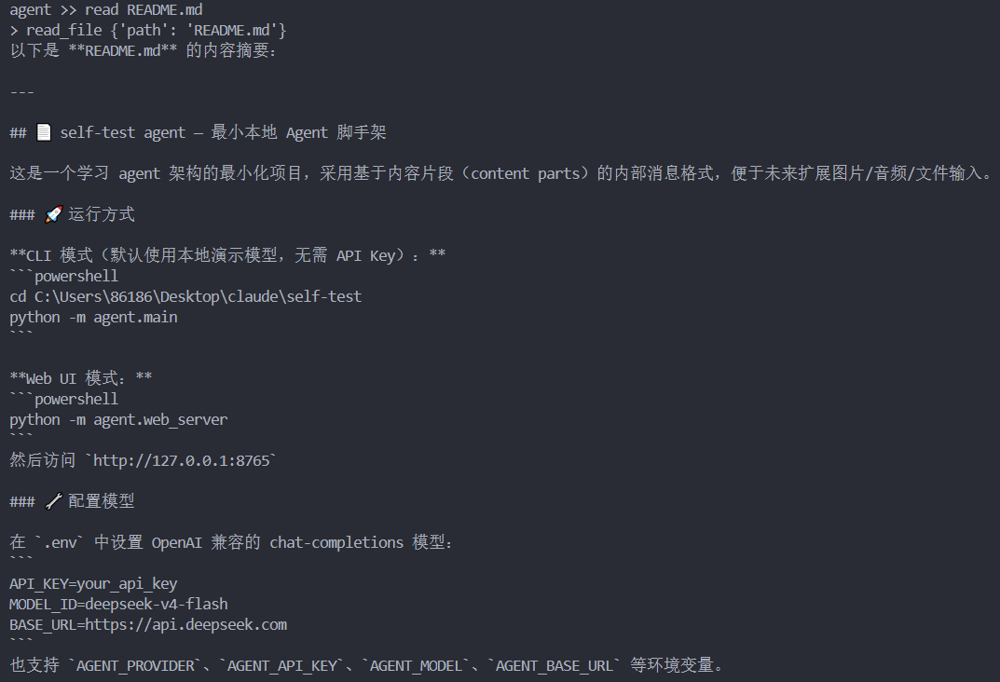
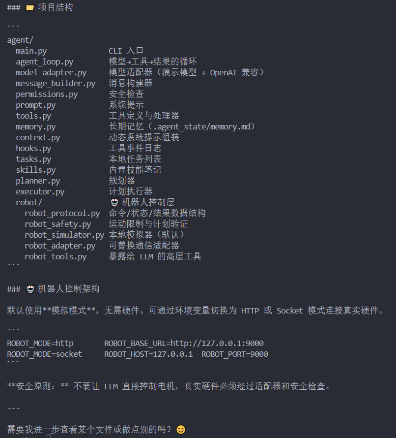
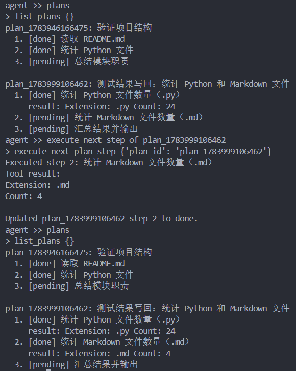
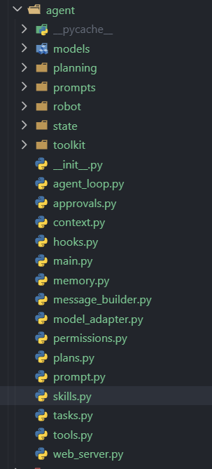
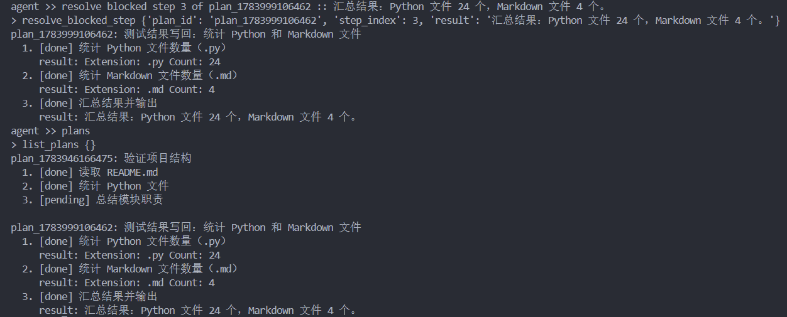
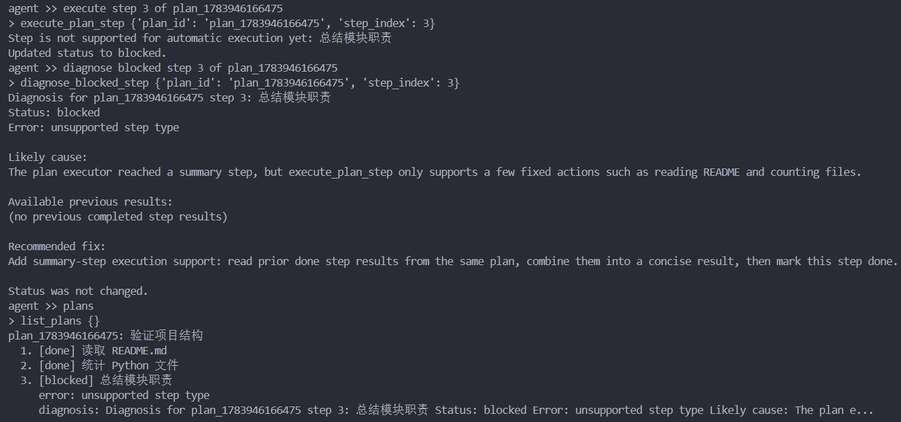
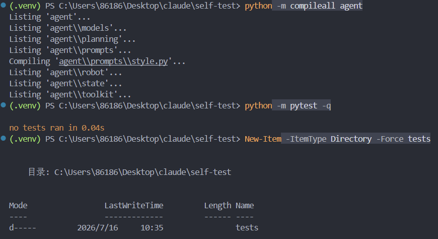

# MicroDuck 智能体技术文档

## 从策略训练到智能体开发全流程

---

## 1 项目概述

MicroDuck 是一个基于强化学习策略的双足机器人智能体系统，由两个核心仓库组成：

- **microduck_rl** (`~/microduck_rl`)：机器人强化学习策略训练与 MuJoCo 仿真环境
- **self-test** (`~/桌面/self-test`)：LLM 驱动的智能体框架，通过工具调用控制机器人

系统的整体架构为：LLM 智能体通过自然语言理解用户意图，调用注册的能力工具，经由 HTTP 网关将指令下发到 MuJoCo 仿真环境中的机器人，同时通过感知服务获取环境反馈，形成"感知-决策-执行"的闭环。



### 1.1 技术栈

| 组件 | 技术 |
|------|------|
| 强化学习训练 | mjlab + MuJoCo + PPO |
| 策略部署 | ONNX Runtime |
| 仿真环境 | MuJoCo 物理引擎 |
| 智能体框架 | Python + LLM (DeepSeek API) |
| 通信协议 | HTTP REST API |
| 感知服务 | Python HTTP Server |

### 1.2 目录结构

```
microduck_rl/
├── scripts/
│   └── infer_policy.py          # ONNX 策略推理 + HTTP Bridge
├── src/mjlab_microduck/
│   ├── tasks/                   # 训练任务定义
│   │   ├── __init__.py           # 任务注册
│   │   ├── microduck_velocity_env_cfg.py
│   │   ├── microduck_standup_env_cfg.py
│   │   ├── microduck_ground_pick_env_cfg.py
│   │   └── ...
│   └── robot/microduck/
│       └── robot_groundcontact.xml
├── my_walk_final.onnx           # 行走策略
├── alpha_stand.onnx             # 站立策略
├── alpha_sitstand.onnx          # 坐立切换策略
├── ball_kick_left.onnx          # 左脚踢球
├── ball_kick_right.onnx         # 右脚踢球
├── roulade.onnx                 # 翻滚
└── alpha_ground_pick.onnx       # 地面拾取

self-test/
├── contracts/                   # 契约层定义
│   ├── capability.py
│   ├── execution.py
│   └── observation.py
├── agent/
│   ├── agent_loop.py            # 单轮对话执行环
│   ├── main.py                  # 入口
│   ├── context.py               # 系统提示构建
│   ├── capabilities/
│   │   └── registry.py          # 能力注册表
│   ├── execution/
│   │   ├── runner.py            # GoalRunner 多步执行
│   │   └── prompts.py
│   ├── models/
│   │   ├── base.py              # ModelAdapter 协议
│   │   └── deepseek.py          # DeepSeek 适配器
│   ├── robot/
│   │   └── policy.py            # 感知安全门
│   ├── permissions.py           # 工具权限检查
│   ├── scheduling/              # 执行调度器
│   └── toolkit/                 # 工具实现
├── robot_runtime/
│   ├── gateway_server.py        # HTTP 网关
│   └── microduck_adapter.py     # MicroDuck 适配器
├── services/
│   └── perception.py            # 感知服务
└── scripts/
    └── start_microduck.sh        # 一键启动脚本
```

---

## 2 策略训练 (microduck_rl)

### 2.1 训练任务概览

microduck_rl 基于 mjlab 框架训练机器人控制策略，使用 PPO 算法在 MuJoCo 仿真环境中进行强化学习。所有任务在 `src/mjlab_microduck/tasks/__init__.py` 中注册：

| 任务 ID | 说明 | 策略文件 |
|---------|------|----------|
| Mjlab-Velocity-Flat-MicroDuck | 平地行走 | my_walk_final.onnx |
| Mjlab-StandUp-Flat-MicroDuck | 起身恢复 | alpha_stand.onnx |
| Mjlab-SitStand-Flat-MicroDuck | 坐立切换 | alpha_sitstand.onnx |
| Mjlab-GroundPick-Flat-MicroDuck | 地面拾取 | alpha_ground_pick.onnx |
| Mjlab-BallKick-Flat-MicroDuck | 踢球 | ball_kick_left/right.onnx |
| Mjlab-Roulade-Flat-MicroDuck | 前滚翻 | roulade.onnx |



### 2.2 训练环境配置

以行走任务为例，训练环境配置在 `microduck_velocity_env_cfg.py` 中定义。

#### 2.2.1 观测空间

观测空间包含以下维度：

- **基础观测**：关节位置 (joint_pos, 14D)、关节速度 (joint_vel, 14D)、投影重力 (projected_gravity, 3D)
- **命令观测**：速度命令 (twist, 3D: vx, vy, vtheta)、头部姿态命令 (head_pose, 4D)、身体姿态命令 (body_pose, 6D)
- **编码器偏置**：actor 使用带偏置的关节位置（模拟真实编码器），critic 使用真实值（特权信息）

统一命令观测布局为 13D：`[twist(3), head_pose(4), body_pose(6)]`，需要 `--new-cmd-obs` 标志。

```python
# 观测配置 (microduck_velocity_env_cfg.py)
cfg.observations["actor"].terms["head_command"] = ObservationTermCfg(
    func=mdp.generated_commands,
    params={"command_name": "head_pose"},
)
cfg.observations["actor"].terms["body_command"] = ObservationTermCfg(
    func=mdp.generated_commands,
    params={"command_name": "body_pose"},
)
```

#### 2.2.2 动作空间

动作空间为 14 维关节位置目标，对应 14 个驱动关节（排除 passive_ 被动关节）。

#### 2.2.3 命令范围

```python
# 速度命令范围
command.ranges.lin_vel_x = (-0.4, 0.4)   # m/s
command.ranges.lin_vel_y = (-0.3, 0.3)   # m/s
command.ranges.ang_vel_z = (-1.0, 1.0)  # rad/s

# 头部姿态命令范围 (4D delta from HOME)
ranges = (
    (-0.05, 0.05),    # neck_pitch
    (-0.05, 0.05),    # head_pitch
    (-0.07, 0.07),    # head_yaw
    (-0.015, 0.015),  # head_roll
)
```

### 2.3 奖励函数

奖励函数设计是策略训练的核心。行走任务的主要奖励项：

| 奖励项 | 权重 | 说明 |
|--------|------|------|
| lin_vel_xy_exp | 正 | 线速度跟踪奖励 |
| ang_vel_z_exp | 正 | 角速度跟踪奖励 |
| head_pose_tracking | 2.0 | 头部姿态跟踪（4关节均值） |
| head_pose_bias | 课程递增 | 头部偏置惩罚（1s EMA L1） |
| action_rate_l2 | -0.1 → -1.0 | 动作平滑性惩罚（课程递增） |
| air_time | 正 | 步态空中时间奖励 |

```python
# 头部姿态跟踪奖励
cfg.rewards["head_pose_tracking"] = RewardTermCfg(
    func=microduck_mdp.head_pose_tracking,
    weight=2.0,
    params={"command_name": "head_pose", "std": 0.5},
)

# 动作平滑性惩罚（课程递增）
cfg.curriculum["action_rate_weight"] = CurriculumTermCfg(
    func=microduck_mdp.reward_weight,
    params={
        "reward_name": "action_rate_l2",
        "weight_stages": [
            {"step": 0, "weight": -0.1},
            {"step": 1500 * NUM_STEPS_PER_ENV, "weight": -1.0},
        ],
    },
)
```

### 2.4 训练命令

```bash
# 进入 microduck_rl 目录
cd ~/microduck_rl

# 训练行走策略（平地）
uv run python -m mjlab.train task=Mjlab-Velocity-Flat-MicroDuck \
    headless=True max_iterations=3000

# 训练站立恢复策略
uv run python -m mjlab.train task=Mjlab-StandUp-Flat-MicroDuck \
    headless=True max_iterations=2000

# 训练坐立切换策略
uv run python -m mjlab.train task=Mjlab-SitStand-Flat-MicroDuck \
    headless=True max_iterations=2000

# 训练地面拾取策略
uv run python -m mjlab.train task=Mjlab-GroundPick-Flat-MicroDuck \
    headless=True max_iterations=2000

# 训练踢球策略
uv run python -m mjlab.train task=Mjlab-BallKick-Flat-MicroDuck \
    headless=True max_iterations=2000

# 训练翻滚策略
uv run python -m mjlab.train task=Mjlab-Roulade-Flat-MicroDuck \
    headless=True max_iterations=2000
```

### 2.5 导出 ONNX

训练完成后，策略网络导出为 ONNX 格式供推理使用：

```bash
# 导出训练好的策略为 ONNX
uv run python -m mjlab.export task=Mjlab-Velocity-Flat-MicroDuck \
    checkpoint=path/to/checkpoint.pt

# 导出的 ONNX 文件可直接用于 infer_policy.py 推理
```

### 2.6 策略推理与 Bridge

`scripts/infer_policy.py` 加载 ONNX 策略在 MuJoCo 中运行，并提供 HTTP Bridge 供外部智能体控制：

```bash
# 基本推理（仅行走 + 站立）
uv run python scripts/infer_policy.py \
    --walking my_walk_final.onnx \
    --standing alpha_stand.onnx

# 加载全部策略并启动 Bridge
uv run python scripts/infer_policy.py \
    --bridge --bridge-port 9001 \
    --new-cmd-obs \
    --walking my_walk_final.onnx \
    --standing alpha_stand.onnx \
    --sitstand alpha_sitstand.onnx \
    --kick-left ball_kick_left.onnx \
    --kick-right ball_kick_right.onnx \
    --roulade roulade.onnx \
    --ground-pick alpha_ground_pick.onnx
```





### 2.7 Bridge HTTP API

Bridge 服务提供以下 HTTP 端点：

| 方法 | 路径 | 说明 |
|------|------|------|
| GET | /health | 健康检查 |
| GET | /robot/state | 获取机器人状态 |
| POST | /robot/walk | 行走命令 (vx, vy, vtheta) |
| POST | /robot/stop | 停止运动 |
| POST | /robot/sit | 坐下 |
| POST | /robot/kick | 踢球 (foot: left/right) |
| POST | /robot/roulade | 翻滚 |
| POST | /robot/ground_pick | 地面拾取 |
| POST | /robot/head | 头部姿态控制 |
| POST | /robot/body_pose | 身体姿态控制 |
| POST | /robot/emergency_stop | 急停 |

---

## 3 智能体框架 (self-test)

### 3.1 契约层 (Contracts)

契约层定义了智能体系统中所有核心数据结构，位于 `contracts/` 目录。

#### 3.1.1 CapabilitySpec — 能力规格

```python
@dataclass(frozen=True)
class CapabilitySpec:
    name: str                    # 能力全名 (domain.tool_name)
    description: str             # 描述
    domain: str                  # 领域 (workspace/command/robot/perception)
    execution_target: CapabilityTarget  # 执行目标
    risk_level: CapabilityRisk   # 风险等级
    tool_name: str               # 对应的工具名
    input_schema: dict           # 输入参数 schema
    tags: tuple[str, ...]        # 标签
```

风险等级 (`CapabilityRisk`)：

| 等级 | 说明 |
|------|------|
| READ | 只读操作 |
| WRITE | 写入操作 |
| EXECUTE | 执行命令 |
| CONTROL | 状态控制 |
| MOTION | 机器人运动 |

执行目标 (`CapabilityTarget`)：

| 目标 | 说明 |
|------|------|
| LOCAL_TOOLKIT | 本地工具（文件操作、命令执行） |
| AGENT_STATE | 智能体内部状态（记忆、任务、计划） |
| ROBOT_GATEWAY | 机器人网关（运动控制） |
| REMOTE_SERVICE | 远程服务（感知） |

#### 3.1.2 ExecutionRequest / ExecutionEvent

```python
@dataclass(frozen=True)
class ExecutionRequest:
    capability: str          # 能力名
    execution_target: str    # 执行目标
    resource_id: str | None  # 资源 ID
    arguments: dict          # 调用参数
    execution_id: str        # 唯一执行 ID
    timeout_s: float         # 超时时间
    metadata: dict           # 元数据

@dataclass(frozen=True)
class ExecutionEvent:
    execution_id: str
    capability: str
    status: ExecutionStatus  # created/running/succeeded/failed/cancelled
    result: Any              # 执行结果
    error: ExecutionError | None
    observation: dict | None # 感知观测数据
```

#### 3.1.3 Observation — 感知观测

```python
@dataclass(frozen=True)
class Observation:
    source: str                    # 数据来源
    path_clear: bool | None        # 路径是否通畅
    objects: tuple[dict, ...]      # 检测到的物体
    obstacles: tuple[dict, ...]    # 障碍物
    confidence: float | None       # 置信度
    image_reference: str | None    # 图像引用
```

### 3.2 能力注册 (Capability Registry)

能力注册表位于 `agent/capabilities/registry.py`，将工具按功能分组为能力组 (CapabilityGroup)。

```python
GROUPS = (
    CapabilityGroup("workspace_read", "workspace",
        CapabilityTarget.LOCAL_TOOLKIT, CapabilityRisk.READ,
        frozenset({"list_files", "read_file", "search_files", ...}),
        ("file", "files", "read", "文件", "目录", "读取", ...),
    ),
    CapabilityGroup("robot_motion", "robot",
        CapabilityTarget.ROBOT_GATEWAY, CapabilityRisk.MOTION,
        frozenset({"robot_move", "robot_rotate", "duck_walk",
                   "duck_kick", "duck_roulade", "duck_ground_pick"}),
        ("robot move", "前进", "鸭子", "走路", "踢球", ...),
    ),
    CapabilityGroup("perception", "perception",
        CapabilityTarget.REMOTE_SERVICE, CapabilityRisk.READ,
        frozenset({"perception_observe", "perception_check_path"}),
        ("perception", "感知", "检查路径", "障碍物", ...),
    ),
    # ... 更多能力组
)
```

能力注册表的核心方法：

- `select(text)` — 根据用户输入文本匹配关键词，选择相关能力组
- `schemas_for_names(tool_names)` — 获取指定工具的 schema
- `prompt_summary(specs)` — 生成能力摘要供 LLM 参考

能力组之间存在依赖关系：

```python
PROFILE_DEPENDENCIES = {
    "workspace_write": frozenset({"workspace_read", "approval"}),
    "robot_motion": frozenset({"robot_observe", "robot_control", "perception"}),
    "robot_control": frozenset({"robot_observe"}),
}
```

当用户提到"前进"时，系统会自动选择 `robot_motion` 能力组，并因其依赖关系同时激活 `robot_observe`、`robot_control` 和 `perception` 能力组。

### 3.3 执行调度 (Dispatcher)

执行调度器 (`ExecutionDispatcher`) 负责将 `ExecutionRequest` 路由到正确的处理器。

```python
def dispatch(self, request: ExecutionRequest) -> ExecutionEvent:
    # 1. 查找能力规格
    capability = self.capability_registry.get_by_name(request.capability)

    # 2. 验证执行目标匹配
    if request.execution_target != capability.execution_target.value:
        raise ValueError(...)

    # 3. 选择资源
    selection = self.resource_selector.select(capability, request.resource_id)
    resource = selection.resource

    # 4. 标记资源忙碌
    self.resource_registry.mark_busy(resource.resource_id)

    # 5. 查找处理器并执行
    target_handler = self._resource_handlers.get(resource.resource_id)
    if target_handler is None:
        target_handler = self._target_handlers[request.execution_target]
    result = target_handler(active_request, capability, resource)

    # 6. 更新资源健康状态
    return self._update_resource_health(event)
```

### 3.4 执行环

系统提供两种执行模式：单轮对话 (`Agent`) 和多步目标执行 (`GoalRunner`)。

#### 3.4.1 单轮对话 (Agent)

`agent/agent_loop.py` 中的 `Agent` 类处理单轮用户交互：

```python
class Agent:
    def run_turn_with_trace(self, text: str) -> dict:
        # 1. 根据用户文本选择能力
        selected_names = {cap.tool_name for cap in CAPABILITY_REGISTRY.select(text)}
        tool_schemas = CAPABILITY_REGISTRY.schemas_for_names(selected_names)

        # 2. 多步工具调用循环
        for _ in range(self.max_steps):
            # 2a. 构建 system prompt（含能力摘要）
            system_prompt = build_system_prompt(self.messages) + capability_prompt

            # 2b. 调用 LLM
            response = self.model.complete(self.messages, tool_schemas, system_prompt)

            # 2c. 如果是文本回复，返回给用户
            if response["type"] == "message":
                return {"answer": response["text"], "events": self.last_events}

            # 2d. 如果是工具调用，执行每个工具
            for call in response["tool_calls"]:
                # 权限检查
                check_user_requested_arguments(name, arguments, text)
                # 感知安全门
                check_motion_against_latest_perception(name, arguments, self.last_events)
                # 调度执行
                execution_event = DISPATCHER.dispatch(request)
                # 记录结果
                self.messages.append(tool_result_message(call["id"], name, result))
```

#### 3.4.2 多步目标执行 (GoalRunner)

`agent/execution/runner.py` 中的 `GoalRunner` 处理需要多步规划的机器人任务，分为三个阶段：

**Phase 1: 获取初始状态**

```python
# 通过 robot_get_status 获取机器人当前状态
status_request = ExecutionRequest(
    capability="robot.robot_get_status",
    execution_target="robot_gateway",
    arguments={},
)
status_event = DISPATCHER.dispatch(status_request)
status_result = tool_result_text(status_event.result)
```

**Phase 2: 生成导航计划**

```python
# 使用 LLM 根据当前状态生成计划
plan_prompt = PLANNING_PROMPT
if self.world_description:
    plan_prompt += f"\n\n{self.world_description}"
plan_prompt += f"\n\nCurrent robot state:\n{status_result}\n\nUser goal:\n{clean_goal}"
plan_response = self.model.complete(plan_messages, [], system_prompt=ROBOT_SYSTEM_PROMPT)
```

**Phase 3: 逐步执行工具**

```python
for step in range(1, self.max_steps + 1):
    # 构建 system prompt（含步骤预算）
    prompt = _build_goal_system_prompt(messages, capability_prompt, GOAL_RULES, step, max_steps)
    response = self.model.complete(messages, self.tool_schemas, system_prompt=prompt)

    # 处理工具调用
    call = response["tool_calls"][0]
    name = call["name"]
    arguments = call["arguments"]

    # 感知安全门检查
    check_motion_against_latest_perception(name, arguments, events)

    # 调度执行
    execution_event = DISPATCHER.dispatch(request)
    result = tool_result_text(execution_event.result)

    # 权限拒绝时终止
    if event["status"] == "failed" and _is_permission_denial(result):
        return self._result(run_id, goal, "blocked", "permission_denied", ...)
```



### 3.5 安全机制

#### 3.5.1 感知安全门 (Perception Gate)

感知安全门是机器人运动的核心安全机制，位于 `agent/robot/policy.py`。所有运动工具在执行前必须通过感知检查。

```python
MOTION_TOOLS = {
    "robot_move", "robot_rotate", "robot_execute_plan",
    "duck_walk", "duck_kick", "duck_roulade", "duck_ground_pick",
}
PERCEPTION_TOOLS = {"perception_observe", "perception_check_path"}

def check_motion_against_latest_perception(tool_name, arguments, events):
    # 1. 非运动工具直接放行
    if tool_name not in MOTION_TOOLS:
        return

    # 2. 查找最近的感知事件
    latest_index = find_latest_perception_event(events)
    if latest_index is None:
        return  # 无感知记录时放行（首次运动）

    # 3. 运动后需要重新感知
    if any(event in MOTION_TOOLS for event in events[latest_index + 1:]):
        raise PermissionError("运动后需要重新感知检查")

    # 4. 感知失败时阻止运动
    if latest.get("status") != "succeeded":
        raise PermissionError("最近的感知请求失败，运动被阻止")

    # 5. 路径不通时阻止运动
    if observation.get("path_clear") is not True:
        raise PermissionError("感知未确认路径通畅，运动被阻止")

    # 6. 路径检查范围验证
    if requested_distance > assessed_distance:
        raise PermissionError("请求的运动距离超出感知检查范围")
```

安全门的工作流程：

1. 用户发出运动指令（如"前进 1 米"）
2. 系统检查事件历史中是否有成功的感知记录
3. 如果没有感知记录，首次运动放行
4. 如果有感知记录但路径不通，运动被阻止
5. 如果运动后需要再次运动，必须先重新执行感知检查

#### 3.5.2 工具权限检查

`agent/permissions.py` 定义了工具权限层级：

```python
SAFE_ROBOT_TOOLS = {
    "robot_stop", "robot_emergency_stop", "robot_get_status",
    "robot_get_action_status", "robot_cancel_action",
    "robot_speak", "robot_capture_image", "duck_stop",
}

MOTION_ROBOT_TOOLS = {
    "robot_move", "robot_rotate", "robot_execute_plan",
    "duck_walk", "duck_sit", "duck_kick", "duck_roulade",
    "duck_ground_pick", "duck_head", "duck_body_pose",
}
```

运动工具需要额外的环境变量授权：

```python
if name in MOTION_ROBOT_TOOLS:
    mode = os.environ.get("ROBOT_MODE", "simulated")
    motion_enabled = os.environ.get("ROBOT_ALLOW_MOTION", "")
    if mode == "simulated" or motion_enabled in {"1", "true", "yes"}:
        return  # 允许
    raise PermissionError("需要设置 ROBOT_ALLOW_MOTION=1 才能控制真实机器人")
```

`run_command` 工具使用白名单机制，且 `python` 命令会被解析为当前解释器路径：

```python
ALLOWED_COMMANDS = {
    ("python", "--version"),
    ("python", "-m", "pytest"),
    ("python", "-m", "pytest", "-q"),
}
```

### 3.6 LLM 模型适配

系统通过 `ModelAdapter` 协议支持多种 LLM 后端：

```python
class ModelAdapter(Protocol):
    def complete(self, messages, tools, system_prompt=None) -> dict:
        ...
```

DeepSeek 适配器使用 OpenAI 兼容 API：

```python
class DeepSeekChatModel(OpenAICompatibleChatModel):
    def __init__(self):
        super().__init__(
            provider_name="deepseek",
            api_key_env="DEEPSEEK_API_KEY",
            default_base_url="https://api.deepseek.com",
            default_model="deepseek-v4-flash",
        )
```

环境变量配置 (`.env`)：

```bash
AGENT_PROVIDER=deepseek
DEEPSEEK_API_KEY=sk-xxxxxxxxxxxxxxxx
MODEL_ID=deepseek-flash
BASE_URL=https://api.deepseek.com
```

### 3.7 机器人运行时

#### 3.7.1 Robot Gateway

`robot_runtime/gateway_server.py` 提供异步 HTTP 网关，管理机器人动作的生命周期：

```python
class RobotGateway:
    MOTION_ACTIONS = {"move", "rotate", "kick", "roulade", "ground_pick"}

    def submit(self, command: RobotCommand) -> RobotResult:
        # 1. 安全验证
        validate_command(command, self.adapter.get_state())

        # 2. 检查是否有正在执行的运动
        if command.action in self.MOTION_ACTIONS and self._active_motion_id():
            return self._store_failure(command, "Robot is busy")

        # 3. 运动动作异步执行
        if command.action in self.MOTION_ACTIONS:
            thread = threading.Thread(target=self._run_motion, ...)
            thread.start()
            return pending_result

        # 4. 非运动动作同步执行
        return self.adapter.execute(command)
```

网关还包含看门狗 (watchdog) 机制，超时未联系时自动取消运动动作。

HTTP 端点：

| 方法 | 路径 | 说明 |
|------|------|------|
| GET | /health | 健康检查 |
| GET | /robot/state | 机器人状态 |
| POST | /robot/actions | 提交动作 |
| GET | /robot/actions/{id} | 查询动作状态 |
| POST | /robot/actions/{id}/cancel | 取消动作 |
| POST | /robot/emergency-stop | 急停 |

#### 3.7.2 MicroDuck 适配器

`robot_runtime/microduck_adapter.py` 将高层 RobotCommand 转换为 Bridge HTTP 调用：

```python
class MicroDuckAdapter:
    def execute(self, command: RobotCommand) -> RobotResult:
        if command.action == "move":
            vx = speed if direction == "forward" else -speed
            return self._post_bridge("/robot/walk",
                {"vx": vx, "vy": 0.0, "vtheta": 0.0}, command)

        if command.action == "walk":
            return self._post_bridge("/robot/walk",
                {"vx": vx, "vy": vy, "vtheta": vtheta}, command)

        if command.action == "kick":
            return self._post_bridge("/robot/kick",
                {"foot": foot}, command)

        if command.action == "ground_pick":
            return self._post_bridge("/robot/ground_pick", {}, command)
```

运动动作的异步执行包含进度反馈和取消支持：

```python
def execute_motion(self, command, cancel_event, feedback):
    result = self.execute(command)
    duration = distance / speed  # 估算执行时间

    while True:
        if cancel_event.is_set():
            self.execute(RobotCommand("stop"))
            return cancelled_result

        if elapsed >= duration:
            self.execute(RobotCommand("stop"))
            return succeeded_result

        feedback(min(0.99, elapsed / duration))
        cancel_event.wait(0.05)
```

### 3.8 感知服务

`services/perception.py` 提供环境感知能力，通过查询机器人网关获取前方障碍物距离：

```python
class SimulatedPerceptionService:
    def execute(self, request: ExecutionRequest) -> dict:
        # 1. 从机器人网关获取状态
        robot_state = self._get_robot_state()
        front_obstacle = robot_state.get("front_obstacle_m")

        # 2. 判断路径是否通畅
        requested_distance = float(payload.get("distance", 1.0))
        path_clear = True

        if front_obstacle is not None:
            if front_obstacle < requested_distance + 0.3:
                path_clear = False
                obstacles_list.append({
                    "label": "obstacle",
                    "distance_m": front_obstacle,
                    "bearing_deg": 0.0,
                })
        else:
            # 无法获取障碍物数据时，保守判断为不通畅
            path_clear = False

        # 3. 返回观测结果
        observation = Observation(
            source="front_sensor",
            path_clear=path_clear,
            obstacles=tuple(obstacles_list),
            confidence=0.95 if front_obstacle is not None else 0.3,
        )
```

感知服务支持两种操作：

- `observe` — 观察环境，返回障碍物列表
- `check_path` — 检查指定方向和距离的路径是否通畅



---

## 4 系统启动与运行

### 4.1 环境准备

```bash
# 克隆仓库
git clone <repo_url> ~/microduck_rl
git clone <repo_url> ~/桌面/self-test

# 安装 microduck_rl 依赖
cd ~/microduck_rl
uv sync

# 安装 self-test 依赖
cd ~/桌面/self-test
pip install -r requirements.txt

# 配置 .env 文件
cp .env.example .env
# 编辑 .env，填入 DEEPSEEK_API_KEY
```

### 4.2 一键启动

```bash
cd ~/桌面/self-test
./scripts/start_microduck.sh
```

启动脚本会依次启动以下服务：

1. **MuJoCo 仿真 + Bridge** (端口 9001) — 加载 ONNX 策略，提供 HTTP Bridge
2. **Robot Gateway** (端口 9000) — 智能体网关，管理机器人动作
3. **Perception Service** (端口 9030) — 感知服务，提供环境观测

```bash
# 启动脚本输出示例
=== MicroDuck Agent Integration ===
  microduck_rl: /home/pc/microduck_rl
  self-test:    /home/pc/桌面/self-test
  bridge port:  9001
  gateway port: 9000

Starting MuJoCo simulation with bridge...
  cd /home/pc/microduck_rl && uv run python scripts/infer_policy.py \
    --bridge --bridge-port 9001 --new-cmd-obs \
    --walking my_walk_final.onnx --standing alpha_stand.onnx \
    --sitstand alpha_sitstand.onnx --kick-left ball_kick_left.onnx \
    --kick-right ball_kick_right.onnx --roulade roulade.onnx \
    --ground-pick alpha_ground_pick.onnx

Bridge is ready.
Starting self-test agent gateway...
Starting perception service...

=== System is running ===
  Bridge:     http://127.0.0.1:9001/health
  Gateway:    http://127.0.0.1:9000/robot/state
  Perception: http://127.0.0.1:9030 (scene=clear)
```

### 4.3 启动智能体

```bash
# 在另一个终端
cd ~/桌面/self-test
PYTHONPATH=. python3 -m agent.main
```

### 4.4 交互示例

```
self-test agent
Type q to quit. Try: list files | read README.md | write notes/new-note.txt :: hello | python version
agent >> 前进1米
> phase 1: acquiring initial robot state
  initial state: {"mode":"microduck","x":0.0,"y":0.0,"theta":0.0,...}
> phase 2: generating navigation plan
  navigation plan:
    1. Check path ahead with perception_check_path
    2. Walk forward 1 meter
    3. Verify final position
> step 1: perception_check_path {'direction': 'forward', 'distance': 1.0}
> step 2: duck_walk {'vx': 0.2, 'vy': 0.0, 'vtheta': 0.0}
> step 3: robot_get_status {}
[robot goal: completed (feedback_verified); steps: 3; report: goal_20260115_...]
```



### 4.5 手动启动各服务

如需单独启动各服务：

```bash
# 1. 启动 MuJoCo 仿真 + Bridge
cd ~/microduck_rl
uv run python scripts/infer_policy.py \
    --bridge --bridge-port 9001 --new-cmd-obs \
    --walking my_walk_final.onnx \
    --standing alpha_stand.onnx

# 2. 启动 Robot Gateway
cd ~/桌面/self-test
ROBOT_RUNTIME_ADAPTER=microduck ROBOT_PORT=9000 \
    python3 -m robot_runtime.gateway_server

# 3. 启动 Perception Service
cd ~/桌面/self-test
python3 -m services.perception --port 9030 --scene clear

# 4. 启动智能体
cd ~/桌面/self-test
PYTHONPATH=. python3 -m agent.main
```

### 4.6 运行测试

```bash
cd ~/桌面/self-test
PYTHONPATH=. python3 -m pytest -q
```



---

## 5 机器人能力清单

### 5.1 运动能力

| 工具名 | 说明 | 参数 |
|--------|------|------|
| duck_walk | 行走 | vx, vy, vtheta |
| robot_move | 移动 | distance, direction, speed |
| robot_rotate | 旋转 | angle, speed |
| duck_kick | 踢球 | foot (left/right) |
| duck_roulade | 翻滚 | — |
| duck_ground_pick | 地面拾取 | — |
| duck_sit | 坐下 | — |
| duck_head | 头部姿态 | neck_pitch, head_pitch, head_yaw, head_roll |
| duck_body_pose | 身体姿态 | z, pitch, roll |

### 5.2 感知能力

| 工具名 | 说明 | 参数 |
|--------|------|------|
| perception_observe | 观察环境 | source |
| perception_check_path | 检查路径 | direction, distance |
| robot_get_status | 获取状态 | — |
| robot_capture_image | 拍照 | — |

### 5.3 控制能力

| 工具名 | 说明 |
|--------|------|
| robot_stop / duck_stop | 停止运动 |
| robot_emergency_stop | 急停 |
| robot_cancel_action | 取消动作 |
| robot_speak | 说话 |

### 5.4 当前限制

- **感知能力**：仅支持一维前方距离感知 (`front_obstacle_m`)，无物体识别
- **导航能力**：无地图构建或路径规划，依赖实时感知
- **操作能力**：无主动抓取自由度，`duck_ground_pick` 仅执行弯腰触地动作
- **相机**：MuJoCo 仿真中相机不可用 (`capture_image` 返回 unavailable)

---

## 6 数据流架构

```
用户输入
  │
  ▼
Agent.run_turn() / GoalRunner.run()
  │
  ├── CapabilityRegistry.select(text)  →  选择能力组
  │
  ├── ModelAdapter.complete()  →  LLM 决策
  │
  ├── check_motion_against_latest_perception()  →  感知安全门
  │
  ├── check_tool_call()  →  权限检查
  │
  ▼
ExecutionDispatcher.dispatch()
  │
  ├── LOCAL_TOOLKIT  →  本地工具执行
  ├── AGENT_STATE  →  状态管理
  ├── ROBOT_GATEWAY  →  HTTP → RobotGateway → MicroDuckAdapter → Bridge → MuJoCo
  └── REMOTE_SERVICE  →  HTTP → PerceptionService → Gateway → Bridge
  │
  ▼
ExecutionEvent (结果 + 观测)
  │
  ▼
反馈给 LLM → 下一步决策
```



---

## 7 关键设计决策

### 7.1 感知先于运动

系统强制要求所有运动工具在执行前通过感知检查。这确保机器人不会在未知环境中盲目运动。如果感知服务不可用或返回 `path_clear=False`，运动被阻止。

### 7.2 LLM 异常容错

所有 LLM API 调用都包裹在 try-except 中，避免 API 故障导致系统崩溃：

```python
try:
    response = self.model.complete(messages, self.tool_schemas, system_prompt=prompt)
except Exception as exc:
    return self._result(run_id, goal, "blocked", "model_unavailable",
                        f"模型请求失败: {exc}", events, ...)
```

### 7.3 运动后重新感知

安全门要求运动后必须重新执行感知检查才能再次运动，防止基于过期感知数据做出决策。

### 7.4 资源忙碌管理

Gateway 确保同一时间只有一个运动动作在执行，防止命令冲突。

### 7.5 看门狗超时

Gateway 内置看门狗，超时未收到联系时自动取消正在执行的运动动作。

---

## 8 附录

### 8.1 环境变量

| 变量名 | 默认值 | 说明 |
|--------|--------|------|
| DEEPSEEK_API_KEY | — | DeepSeek API 密钥 |
| MODEL_ID | deepseek-flash | 模型 ID |
| BASE_URL | https://api.deepseek.com | API 地址 |
| ROBOT_PORT | 9000 | 网关端口 |
| ROBOT_RUNTIME_ADAPTER | simulated | 运行时适配器 |
| ROBOT_ALLOW_MOTION | — | 允许真实机器人运动 |
| MICRODUCK_BRIDGE_URL | http://127.0.0.1:9001 | Bridge 地址 |
| PERCEPTION_SCENE | clear | 感知场景 |

### 8.2 端口分配

| 服务 | 默认端口 |
|------|----------|
| MuJoCo Bridge | 9001 |
| Robot Gateway | 9000 |
| Perception Service | 9030 |

### 8.3 ONNX 策略文件

| 文件名 | 任务 | 说明 |
|--------|------|------|
| my_walk_final.onnx | Velocity-Flat | 行走 |
| alpha_stand.onnx | StandUp-Flat | 站立恢复 |
| alpha_sitstand.onnx | SitStand-Flat | 坐立切换 |
| alpha_ground_pick.onnx | GroundPick-Flat | 地面拾取 |
| ball_kick_left.onnx | BallKick-Flat | 左脚踢球 |
| ball_kick_right.onnx | BallKick-Flat | 右脚踢球 |
| roulade.onnx | Roulade-Flat | 前滚翻 |
