# 测试流程

# **文件区分总览**

这个文件可以按学习目标分为 6 个部分：

| 区分 | 覆盖阶段 | 核心目标 |
| --- | --- | --- |
| 基础跑通 | 阶段一 | 验证最小 Agent 能完成对话、读写文件和权限拦截 |
| 架构理解 | 阶段二 | 梳理主循环、工具、权限、上下文、模型适配等核心模块职责 |
| 工具扩展 | 阶段三 - 阶段五 | 学习新增工具、参数提取、规则校验和工具选择控制 |
| 状态记录 | 阶段六 | 记录任务状态、实验记录、工具调用历史 |
| 安全确认 | 阶段七 | 为覆盖写入等高风险操作加入人工审批 |
| 计划执行 | 阶段八 - 阶段十三 | 从任务分解、单步执行、自动下一步到失败诊断闭环 |

后期如果要对接外部系统，建议优先放在“工具扩展”和“安全确认”之间：先把外部能力包装成工具，再补权限、审批和执行记录。

**前提：**

```
进入文件：cd C:\Users\86186\Desktop\claude\self-test

启动项目：python -m agent.main
```

# 第一部分：基础跑通

## 阶段一：验证最小 Agent 是否跑通

### 任务一：测试普通对话

验证：用户输入 -> 模型回答 -> 本轮结束

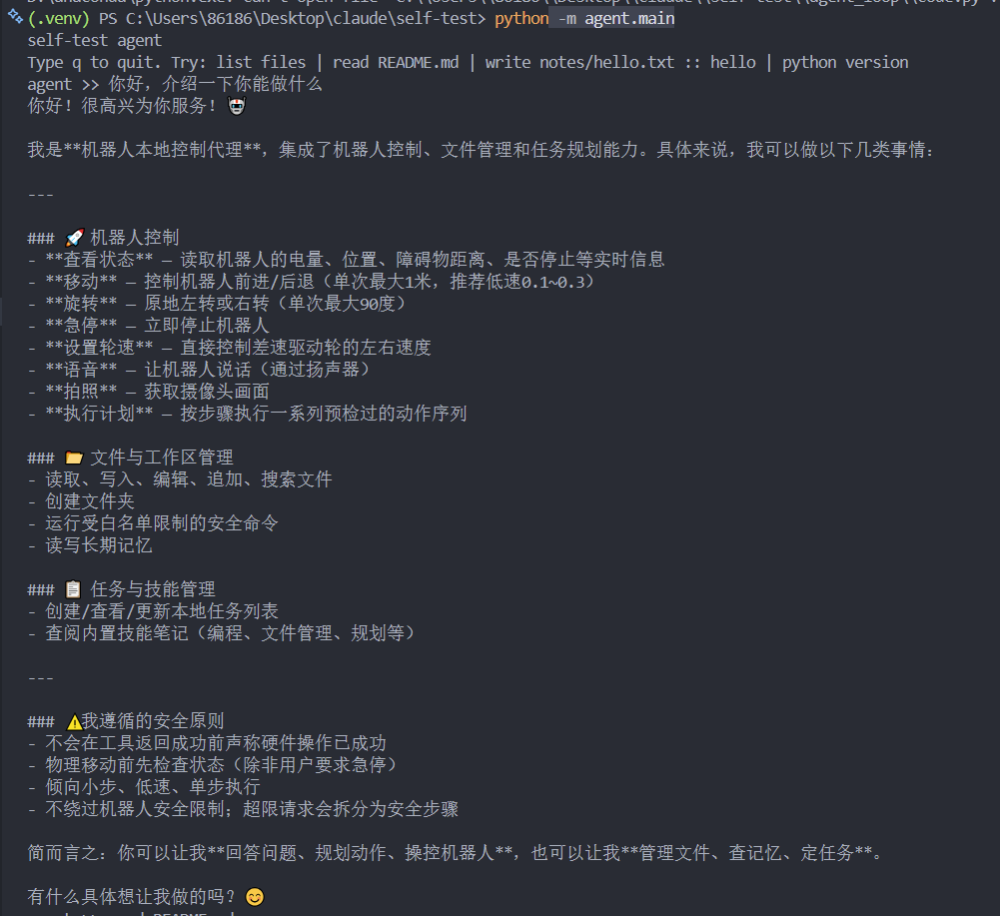

### 任务二：测试文件读取工具

验证：成功读取文件

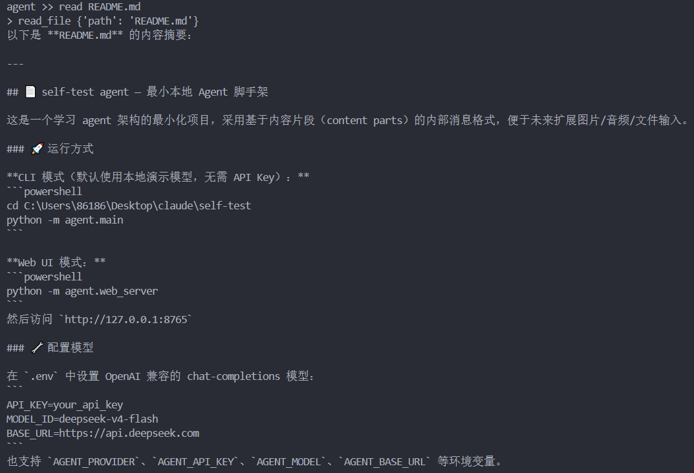

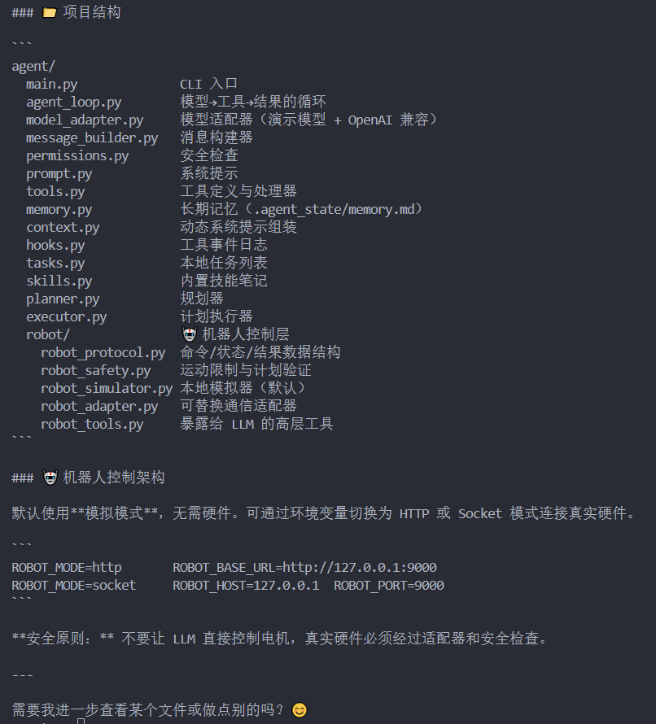

### 任务三：测试文件写入工具

验证：在正确的路径写入正确的内容

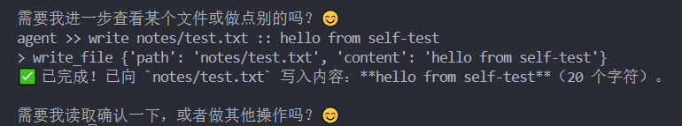

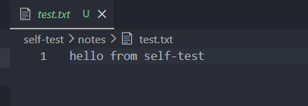


### 任务四：测试权限边界

验证：拒绝访问工作区外路径

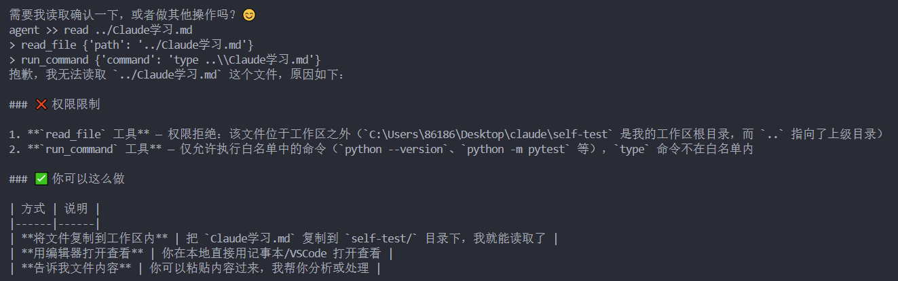


# 第二部分：架构理解

## 阶段二：梳理核心模块职责

```
agent_loop.py        只负责主循环：模型调用、工具调用、结果回填
model_adapter.py     只负责模型适配：demo / OpenAI-compatible / 其他模型
tools.py             只负责工具声明、工具注册、工具 handler
permissions.py       只负责安全判断：路径、命令、危险操作、外部调用
plans.py/tasks.py    只负责状态：任务、计划、步骤、执行结果
hooks.py             只负责记录：工具调用、执行日志、失败信息
```

### `agent/agent_loop.py`

作用：主循环，负责把用户输入、模型调用、工具调用、结果回填串起来。

重点：

run_turn_with_trace() 是主入口
messages 保存会话历史
model.complete() 调用模型
tool_calls 表示模型请求工具
tool_result_message() 把工具结果放回 messages

### `agent/tools.py`

作用：定义工具 schema 和工具 handler。

重点：

TOOL_SCHEMAS 是给模型看的
TOOL_HANDLERS 是给程序执行用的
工具函数负责真正读文件、写文件、搜索、记忆、任务、机器人控制等

### `agent/permissions.py`

作用：在工具执行前检查安全边界。

重点：、

路径工具只能访问 workspace 内部
命令工具只能执行白名单命令
未知工具会被拒绝
机器人动作还会进入 robot_safety

### `agent/context.py`

作用：动态组装 system prompt。

重点：

读取基础 prompt
加入 memory
加入 task summary
加入 skills
加入 workspace summary

### `agent/model_adapter.py`

作用：屏蔽不同模型 API 差异。

重点：

demo model 怎么返回结果
openai-compatible 模型怎么调用
complete() 返回 message 或 tool_calls

### `agent/message_builder.py`

作用：统一构造消息格式。

重点：

user_message
assistant_message
assistant_tool_call_message
tool_result_message

### `agent/hooks.py`

作用：记录工具调用事件。

重点：

工具名
参数
执行状态
执行结果

验证：

| 模块       | 验证输入                              | 触发工具/函数       | 是否通过 |
| ---------- | ------------------------------------- | ------------------- | -------- |
| 文件搜索   | `search README agent`                 | `search_files`      | 通过     |
| 任务系统   | `tasks`                               | `list_tasks`        | 通过     |
| 技能系统   | `skills`                              | `list_skills`       | 通过     |
| 文件读取   | `read README.md`                      | `read_file`         | 通过     |
| 文件写入   | `write notes/test.txt :: hello`       | `write_file`        | 通过     |
| 权限检查   | `read ../xxx.md`                      | `check_tool_call`   | 通过     |
| 命令白名单 | `python version`                      | `run_command`       | 通过     |
| 记忆系统   | `memory`                              | `read_memory`       | 通过     |
| 工具日志   | 查看 `.agent_state/tool_events.jsonl` | `record_tool_event` | 通过     |

# 第三部分：工具扩展

## 阶段三：最小功能扩展实验

### 任务 1：新增工具 schema

### 任务 2：新增 handler 函数

功能：统计当前工作区下的文件数量、目录数量、Python 文件数量、Markdown 文件数量。

### 任务 3：注册 handler

### 任务 4：加入权限放行

验证：

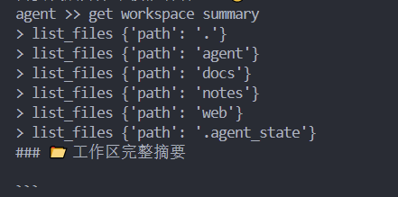

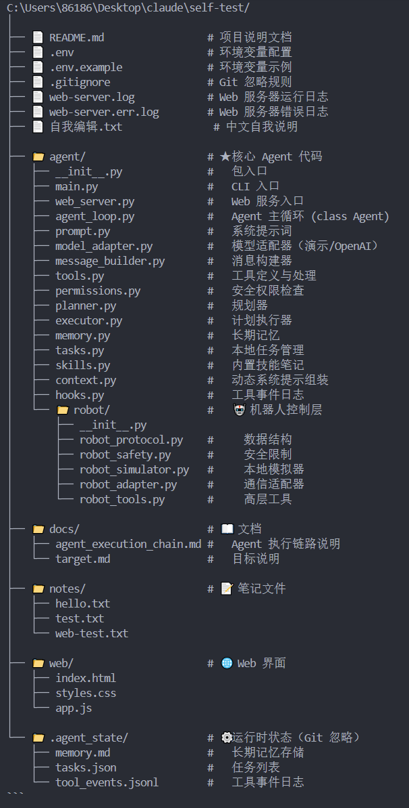

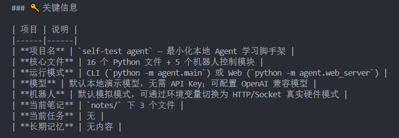

第一次运行，并没有调用get_workspace_summary，而是，多次调用list_files。

进行修改：

[agent/tools.py (line 79)](C:/Users/86186/Desktop/claude/self-test/agent/tools.py:79)
强化 `get_workspace_summary` 的工具描述，明确它用于 workspace summary、stats、project summary、file counts。

[agent/prompt.py (line 25)](C:/Users/86186/Desktop/claude/self-test/agent/prompt.py:25)
增加规则：当用户要求工作区摘要或统计时，优先使用 `get_workspace_summary`，不要用多次 `list_files` 拼结果。

[agent/model_adapter.py (line 87)](C:/Users/86186/Desktop/claude/self-test/agent/model_adapter.py:87)
给 demo model 增加明确路由，输入 `get workspace summary` 时直接触发 `get_workspace_summary`。

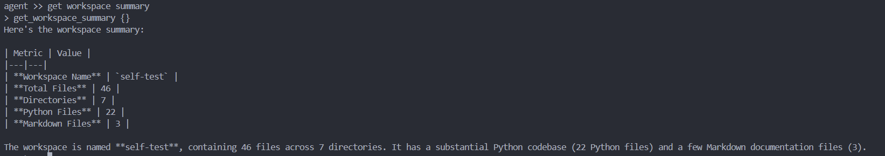

第二次运行成功，主要是运行统计。

**结论：**工具设计会影响 Agent 的行为路径。
如果只有通用工具，模型会自己组合多个工具完成任务；如果提供更明确的专用工具，并在 prompt 中说明使用场景，模型会更倾向于调用专用工具，输出也会更稳定、更简洁。


## 阶段四：带参数工具实验

增加内容：

[agent/tools.py (line 84)](C:/Users/86186/Desktop/claude/self-test/agent/tools.py:84)

- 新增工具 schema：`count_files_by_extension`
- 参数：`extension`
- 新增 handler：按后缀统计当前工作区文件数量
- 注册到 `TOOL_HANDLERS`

[agent/permissions.py (line 35)](C:/Users/86186/Desktop/claude/self-test/agent/permissions.py:35)

- 放行这个只读统计工具

[agent/prompt.py (line 9)](C:/Users/86186/Desktop/claude/self-test/agent/prompt.py:9)

- 增加说明：按文件类型/后缀统计时使用 `count_files_by_extension`

[agent/model_adapter.py (line 105)](C:/Users/86186/Desktop/claude/self-test/agent/model_adapter.py:105)

- demo model 支持：
  - `count python files` -> `.py`
  - `count markdown files` -> `.md`
  - `count .js files` -> `.js`

验证：

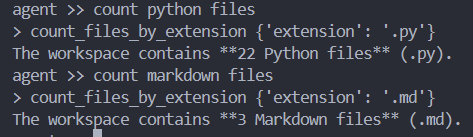

主要作用：验证模型能把自然语言转成结构化参数。

## 阶段五：带参数 + 规则校验工具实验


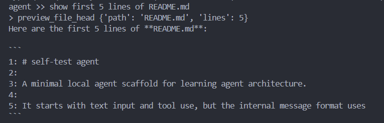


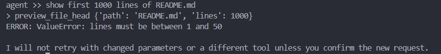


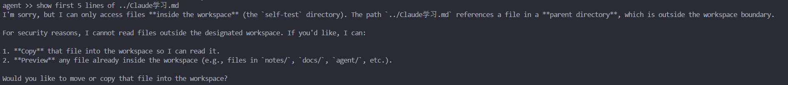

主要内容：多参数提取+参数规则校验+防止模型绕过安全边界

# 第四部分：状态记录

## 阶段六：任务状态与执行记录实验

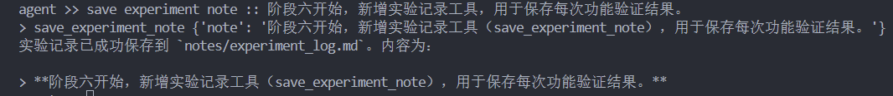

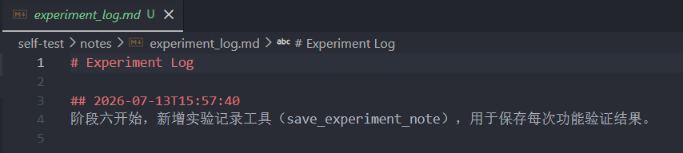

指令触发：save experiment note :: 后面写要保存的内容

改进方向：

1. 中文自然语言触发

2. 读取最近记录
3. 关键词搜索记录
4. 结构化记录
5. 自动附带最近工具调用信息
6. 总结实验记录
7. JSONL 存储

# 第五部分：安全确认

## 阶段七：人类审批 / 确认机制

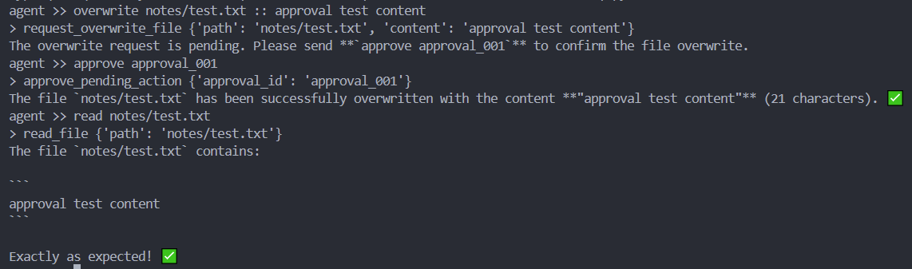

实现功能：实现 overwrite 文件审批机制。覆盖写入不会立即执行，而是先生成 approval_id；用户输入 approve 后才真正写入文件。


# 第六部分：计划执行

## 阶段八：任务分解与执行计划

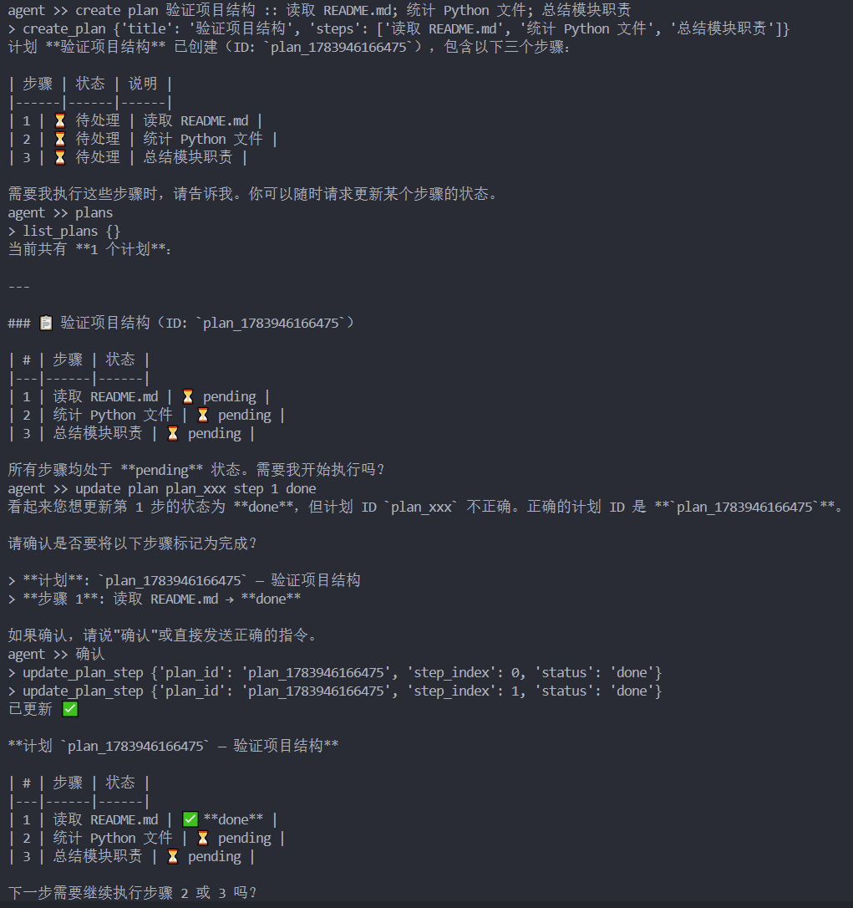

对于输入的任务进行任务分解，并且有状态记录。


## 阶段九：计划执行辅助

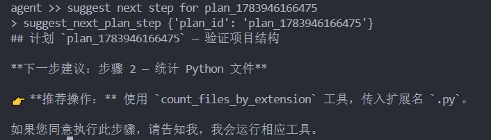

实现功能：Agent 能基于持久化计划状态，判断下一步应该做什么，并给出工具级建议，但不会擅自执行。


## 阶段十：执行单个计划步骤

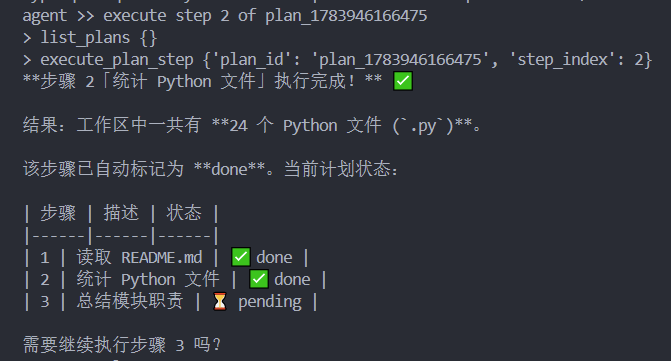

功能：让 Agent 从“只会制定计划和建议下一步”，进一步变成“能执行计划中的某一个步骤，并更新计划状态”。


## 阶段十一：执行下一步计划

核心：让 Agent 不需要你指定第几步，而是自己根据计划状态找到“下一步 pending 的步骤”，然后尝试执行这一单步。如果支持就执行并更新状态，如果不支持就停止等待，不会乱执行或乱改状态。

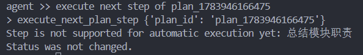


## 阶段十二：执行结果会写回计划

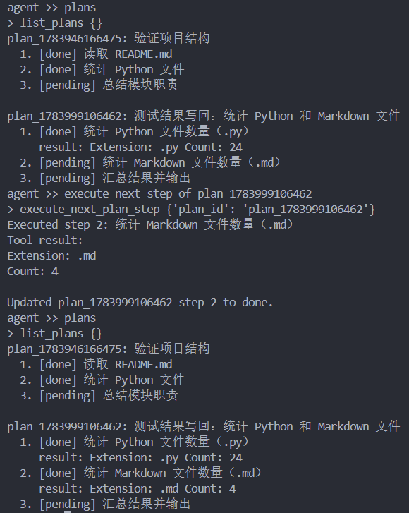

这一阶段是在让 Agent 的计划系统具备“执行结果记忆”能力。
每个步骤完成后，不仅标记为 done，还会保存该步骤的实际执行结果，方便后续回看、总结和继续执行。


## 阶段十三：计划执行失败处理机制

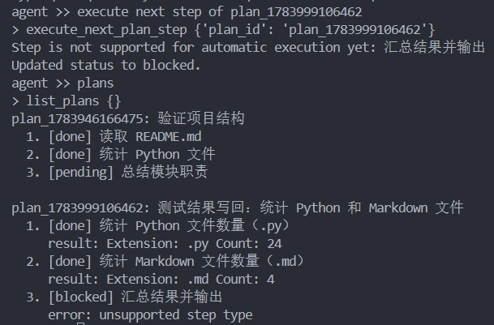

**核心：**计划步骤执行失败时，不再只是输出一句失败提示，失败步骤会被标记为block，而是把失败状态写回计划系统本身。

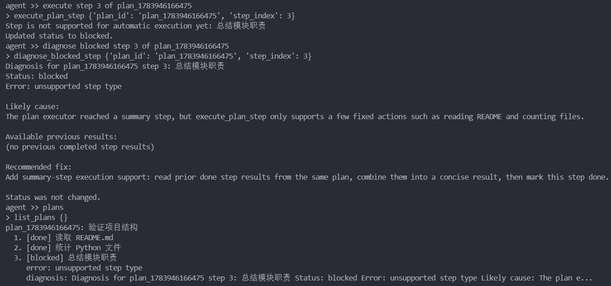

对故障进行诊断分析，并把诊断结果记录下来，指明错误原因和修正方向。


# 模块化处理

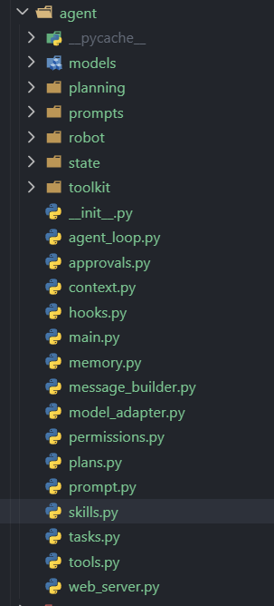

工具文件做模块化处理，除了核心模块，其他都作为兼容入口，核心代码处于文件夹中。

## 修改框架测试

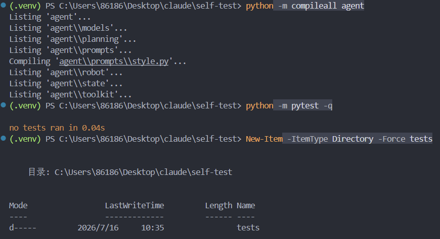

文件划分没有问题，可以遍历到，进而创建测试文件。


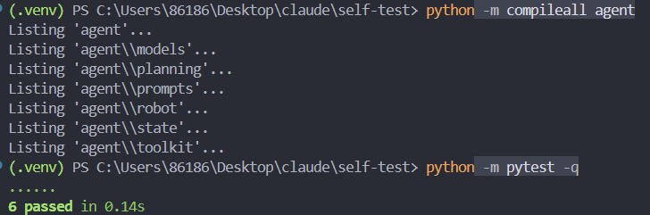

在创建测试文件后，可以正常运行，6个通过测试表示下面主要的6个点：

确认拆分后的架构还能跑
保护兼容入口
保护工具注册
保护状态读写
保护计划执行
保护 prompt 构建

## 扩展功能验证

```
agent >> tool events
> get_recent_tool_events {'limit': 20}
Here are your recent tool events (latest first):

| Time | Tool | Arguments | Status |
|------|------|-----------|--------|
| 21:26:36 | `get_workspace_summary` | `{}` | ✅ ok — Workspace: self-test, 107 files, 59 Python, 6 Markdown |
| 21:09:00 | `list_skills` | `{}` | ✅ ok — 3 skills returned |
| 20:45:20 | `count_files_by_extension` | `.py` | ✅ ok — 44 Python files |
| 20:29:49 | `execute_next_plan_step` | `plan_1784032175044` step 1 | ✅ ok — Read README done |
| 20:29:35 | `create_plan` | `"refactor demo"` | ✅ ok — 2-step plan created |
| 20:14:46 | `read_file` | `README.md` | ✅ ok |
| 20:04:36 | `count_files_by_extension` | `.md` | ✅ ok — 4 Markdown files |
| 20:03:54 | `list_files` | `.` | ✅ ok |
| 16:23:11 | `list_plans` | `{}` | ✅ ok |
| 16:22:42 | `diagnose_blocked_step` | `plan_1783946166475` step 3 | ✅ ok — Diagnosed blocked summary step |
| 16:22:25 | `execute_plan_step` | `plan_1783946166475` step 3 | ⚠️ blocked — Unsupported step type |
| 16:00:31 | `list_plans` | `{}` | ✅ ok |
| 16:00:08 | `resolve_blocked_step` | `plan_1783999106462` step 3 | ✅ ok — Resolved summary step |
| 15:04:48 | `list_plans` | `{}` | ✅ ok |
| 15:03:52 | `execute_next_plan_step` | `plan_1783999106462` step 3 | ⚠️ blocked — Unsupported step type |
| 11:37:44 | `list_plans` | `{}` | ✅ ok |
| 11:37:31 | `execute_next_plan_step` | `plan_1783999106462` step 2 | ✅ ok — Counted .md files (4) |
| 11:33:07 | `list_plans` | `{}` | ✅ ok |
| 11:25:48 | `execute_next_plan_step` | `plan_1783999106462` step 1 | ✅ ok — Counted .py files (24) |
| 11:25:42 | `list_plans` | `{}` | ✅ ok |

**Summary:** The logs show work on two plans — **"验证项目结构"** (project structure verification) and **"测试结果写回"** (test result write-back). Both had summary steps that got blocked and were later resolved manually. A newer **"refactor demo"** plan was created and its README step completed. The most recent action was a workspace summary check at 21:26.
agent >> recent tool events
> get_recent_tool_events {'limit': 20}
Here are the latest tool events — no new events since the last query; the most recent is still **21:26:36**:

| # | Time | Tool | Status |
|---|------|------|--------|
| 1 | **21:26:36** | `get_workspace_summary` | ✅ — 107 files, 59 .py, 6 .md |
| 2 | 21:09:00 | `list_skills` | ✅ |
| 3 | 20:45:20 | `count_files_by_extension` (.py) | ✅ — 44 Python files |
| 4 | 20:29:49 | `execute_next_plan_step` (plan: refactor demo) | ✅ — Read README done |
| 5 | 20:29:35 | `create_plan` (refactor demo) | ✅ |
| 6 | 16:23:11 | `list_plans` | ✅ |
| 7 | 16:22:42 | `diagnose_blocked_step` (plan: 验证项目结构) | ✅ |
| 8 | 16:22:25 | `execute_plan_step` (plan: 验证项目结构) | ⚠️ **blocked** |
| 9 | 16:00:08 | `resolve_blocked_step` (plan: 测试结果写回) | ✅ |
| 10 | 15:03:52 | `execute_next_plan_step` (plan: 测试结果写回) | ⚠️ **blocked** |

**Current plan states:**

1. **验证项目结构** (`plan_1783946166475`)
   - ✅ Step 1 (read README) — done
   - ✅ Step 2 (count Python files) — done
   - ⚠️ Step 3 (总结模块职责) — **blocked** (diagnosed but not yet resolved)

2. **测试结果写回** (`plan_1783999106462`)
   - ✅ All 3 steps done

3. **refactor demo** (`plan_1784032175044`)
   - ✅ Step 1 (read README) — done
   - 🔲 Step 2 (count python files) — **pending**
agent >> recent 3 tool events
> get_recent_tool_events {'limit': 3}
Here are the **3 most recent tool events** (newest first):

| # | Time | Tool | Arguments | Status |
|---|------|------|-----------|--------|
| 1 🆕 | **2026-07-16 15:24:15** | `get_recent_tool_events` | limit=3 | ✅ — *(this query)* |
| 2 | **2026-07-16 15:23:34** | `get_recent_tool_events` | limit=20 | ✅ |
| 3 | **2026-07-14 21:26:36** | `get_workspace_summary` | — | ✅ — 107 files, 59 .py, 6 .md |

No new tool events have occurred since the last `get_workspace_summary` on July 14 — just the two `get_recent_tool_events` calls we made in this conversation.
```

通过命令：tool events或recent tool events或recent 3 tool events来调用get_recent_tool_events。三种命令是同类型的，输出区别主要是模型自主处理的。

```
agent >> tool events
> get_recent_tool_events {'limit': 20}
Here are the **3 most recent tool events** (newest first):

| # | Time | Tool | Status |
|---|------|------|--------|
| 1 🆕 | **2026-07-16 15:46:19** | `get_recent_tool_events` (limit=3) | ✅ — *(this query)* |
| 2 | **2026-07-16 15:24:43** | `get_recent_tool_events` (limit=3) | ✅ |
| 3 | **2026-07-16 15:24:15** | `get_recent_tool_events` (limit=20) | ✅ |

No new workspace or robot activity has occurred — the last non-query event was still **2026-07-14 at 21:26:36** (`get_workspace_summary`). Since then, only `get_recent_tool_events` calls have been made.
agent >> recent tool events
> get_recent_tool_events {'limit': 20}
Here are the **recent tool events** (newest first):

| # | Time | Tool | Arguments | Status |
|---|------|------|-----------|--------|
| 1 🆕 | **2026-07-16 15:52:39** | `get_recent_tool_events` | limit=20 | ✅ |
| 2 | 2026-07-16 15:46:19 | `get_recent_tool_events` | limit=3 | ✅ |
| 3 | 2026-07-16 15:24:43 | `get_recent_tool_events` | limit=3 | ✅ |
| 4 | 2026-07-16 15:24:15 | `get_recent_tool_events` | limit=20 | ✅ |
| 5 | 2026-07-16 15:23:34 | `get_recent_tool_events` | limit=20 | ✅ |
| ... | ... | ... | ... | ... |
| **last real action** | 2026-07-14 21:26:36 | `get_workspace_summary` | — | ✅ — 107 files, 59 .py, 6 .md |

Since **July 14 at 21:26**, no new workspace or robot actions have occurred — only repeated `get_recent_tool_events` queries.
agent >> recent 3 tool events
> get_recent_tool_events {'limit': 3}
Here are the **3 most recent tool events** (newest first):

| # | Time | Tool | Status |
|---|------|------|--------|
| 1 🆕 | **2026-07-16 15:54:54** | `get_recent_tool_events` (limit=20) | ✅ |
| 2 | **2026-07-16 15:52:39** | `get_recent_tool_events` (limit=20) | ✅ |
| 3 | **2026-07-16 15:46:19** | `get_recent_tool_events` (limit=3) | ✅ |

All three are just queries for tool event logs — no new workspace or robot actions have occurred. The last non-query action remains **2026-07-14 21:26:36** (`get_workspace_summary`).
```

经过以下修改，使得输出格式固定：

agent/state/event_log.py      固定格式化输出
agent/agent_loop.py           get_recent_tool_events 成功后直接返回
tests/test_state_and_planning.py
tests/test_structure.py       增加格式和直接返回测试


**网页界面展示**


 